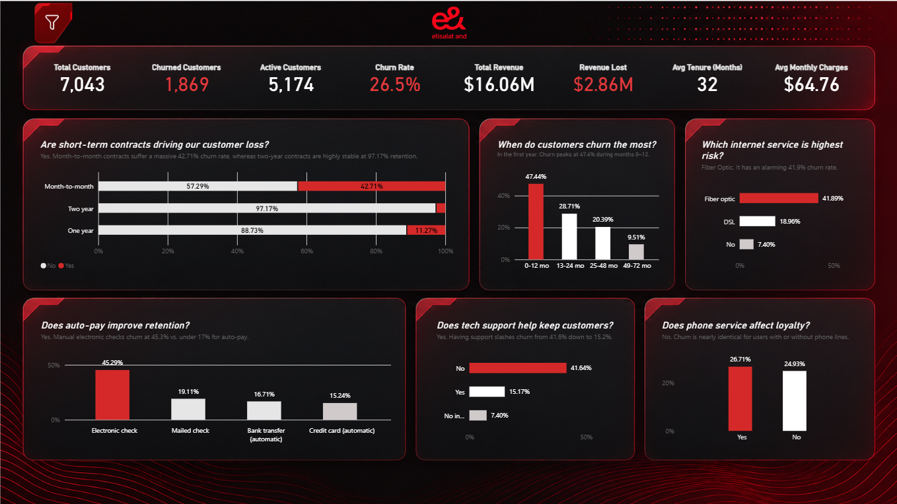
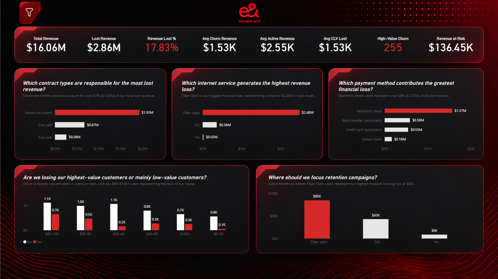
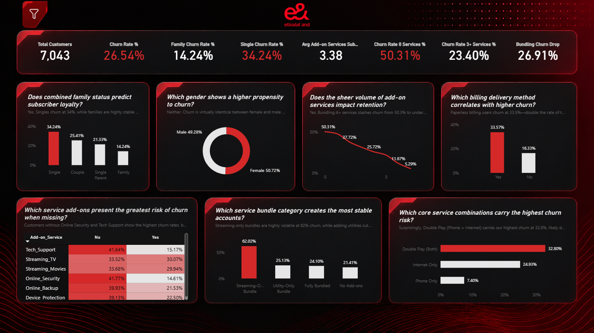
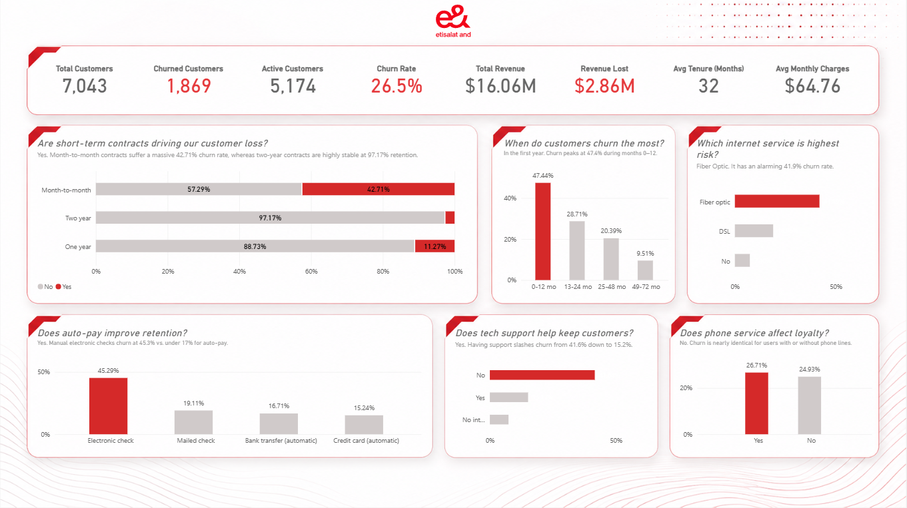

# Telecom Customer Churn Dashboard (Power BI)

An interactive, 4-page Power BI report that analyzes **why customers leave, how much revenue that costs, and where retention campaigns should focus**. The design follows the e& (Etisalat) brand look, with a dark theme and a light-theme overview.

> **Note:** The dataset is **synthetic**: 7,043 simulated customer records, not real customer data. This is a portfolio project and is not affiliated with e& or Etisalat.



---

## Business questions answered

Every chart is titled as a question and has a one-line answer under it, so a stakeholder can read the story without any training.

| Page | Focus | Example questions |
|---|---|---|
| **Overview** | Churn behavior | Are short-term contracts driving customer loss? When do customers churn most? Which internet service is highest risk? Does auto-pay improve retention? |
| **Revenue Impact & Risk Mitigation** | Money lost and where to act | Which contract types, services and payment methods cost the most revenue? Are we losing high-value customers? Where should retention campaigns focus? |
| **Customer Demographics & Value Bundling Optimization** | Who churns and the effect of bundling | Does family status predict loyalty? Does the number of add-on services affect retention? Which add-ons carry the most risk when missing? |
| **Overview Bright** | Light-theme variant of the Overview page | Same content in a light theme |

---

## Headline KPIs

| Metric | Value |
|---|---|
| Total customers | 7,043 |
| Churned customers | 1,869 |
| Churn rate | 26.5% |
| Total revenue | $16.06M |
| Revenue lost to churn | $2.86M (17.83%) |
| High-value churned customers | 255 |
| Revenue at risk | $136.45K |

## Key findings

- **Contract type is the strongest lever.** Month-to-month customers churn at **42.71%**, versus 11.27% on one-year and about 3% on two-year contracts. Month-to-month accounts for over 67% of lost revenue ($1.93M).
- **The first year is the danger zone.** Churn peaks at **47.4% in months 0–12** and falls steadily with tenure.
- **Fiber optic is the biggest leak.** It has a 41.89% churn rate and accounts for $2.48M of lost revenue. Active month-to-month fiber customers are the largest forward-looking risk ($85K).
- **Payment method matters.** Electronic-check customers churn at **45.3%**, against under 17% for automatic payment. They also account for over 54% of lost revenue.
- **Tech support and add-ons retain customers.** Having tech support cuts churn from 41.6% to 15.2%. Churn falls from 50.3% with no add-ons to under 6% at the highest add-on counts.
- **Family status and billing delivery.** Single customers churn at 34.2% against 14.2% for families. Paperless-billing customers churn at 33.6%, roughly double the rate of those without it.
- **Gender and phone service are not meaningful drivers.** Churn is nearly identical across these groups.

## Screenshots

| Revenue Impact & Risk Mitigation | Customer Demographics & Bundling |
|---|---|
|  |  |

**Light-theme overview**



---

## Data model

The report uses a **star schema**:

- `fact_Billing_Churn` is the fact table, with billing and churn data per customer
- `dim_Customer` holds customer attributes
- `dim_Contract` holds contract details
- `dim_Service` and `dim_Service_Unpivoted` hold service and add-on details
- `_Measures` is a dedicated table for DAX measures

## Tools

- **Power BI Desktop** for the data model, DAX measures, report design and a custom crimson theme
- **DAX** for churn rate, revenue lost, high-value churn and revenue-at-risk measures
- Bookmarks and a filter panel for slicing by account profile and services

## How to use

1. Clone or download this repository.
2. Open `Telecom_Churn.pbix` in [Power BI Desktop](https://powerbi.microsoft.com/desktop/) (free).
3. Use the filter button at the top-left of each page to slice the data.

## Repository structure

```
Telecom-Churn-Dashboard/
├── Telecom_Churn.pbix     # Power BI report file
├── images/                # Dashboard screenshots
└── README.md
```

---

## Author

**Mohamed Al Nady**, data analyst focused on SQL, Power BI and DAX.
GitHub: [Nady-07](https://github.com/Nady-07)
